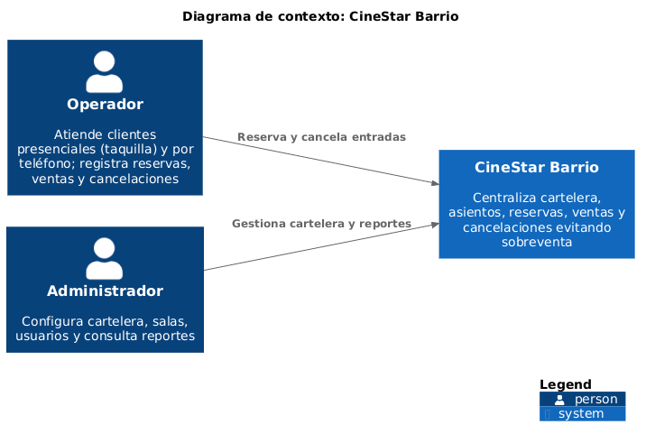
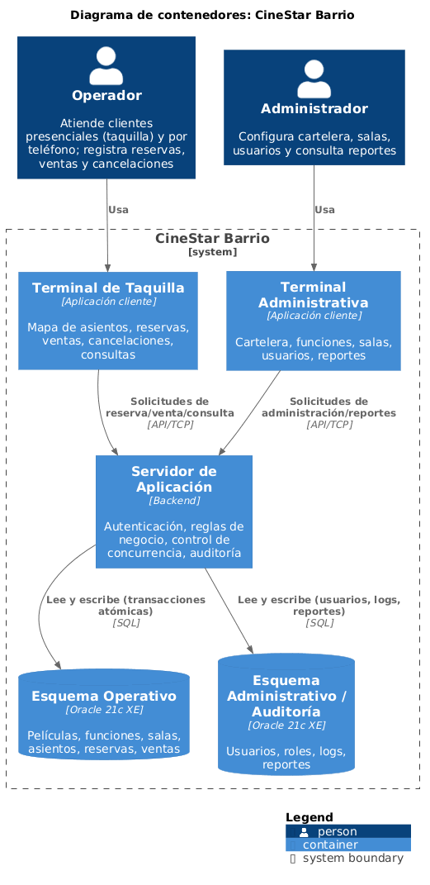
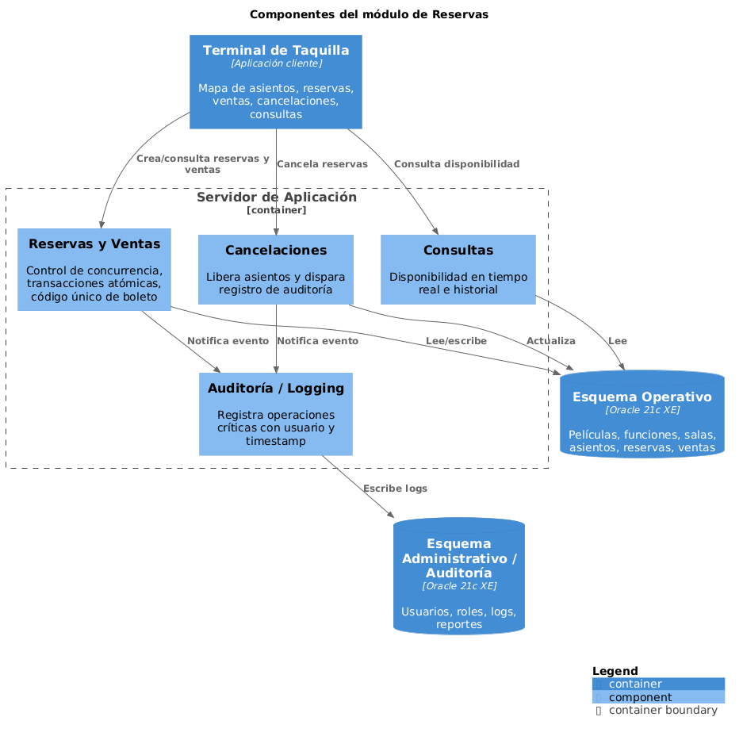
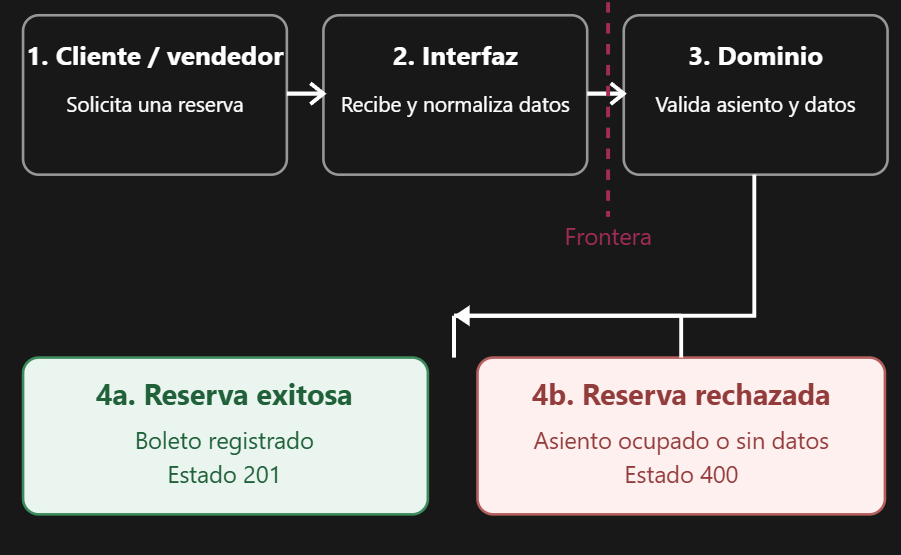
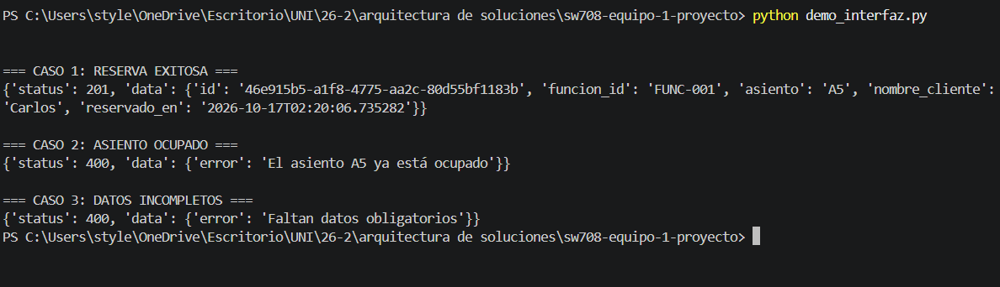

UNIVERSIDAD NACIONAL DE INGENIERÍA

Facultad de Ingeniería Industrial y de Sistemas

Escuela Profesional de Ingeniería de Software

SW708 Arquitectura de Soluciones de Software

Sección U

Profesor: Elio Navarrete Vilca

# Informe del proyecto integrador

Entrega 1

Lumiere

Equipo N.º 1

| N.º | Apellidos y nombres | Código | Rol |
| --- | --- | --- | --- |
| 1 | Chavez Oliva Carlos Daniel | 20232622E | Coordinador |
| 2 | Albornoz Azurza Gonzalo Alessandro | 20232551K | Integrante |
| 3 | Suazo Zanabria Dino Paul Roel | 20231324K | Integrante |
| 4 | Vargas Ponce Luis Angel | 20231314E | Integrante |
| 5 | Zamudio Sánchez Farid Paolo | 20231215G | Integrante |

| Repositorio | https://github.com/Farid-ZS/sw708-equipo-1-proyecto |
| --- | --- |
| Commit revisado | 9b99379 |

Lima, octubre de 2026

## Registro de versiones

Una fila por semana de trabajo, no una sola fila el día de la entrega.

| Versión | Fecha | Autor | Descripción de la modificación |
| --- | --- | --- | --- |
| 0.1 | 19/09/2026 | Equipo 1 | Elaboración y revisión de los escenarios de calidad y del modelo C4 del sistema Lumiere. |
| 0.2 | 11/10/2026 | Equipo 1 | Documentación de decisiones arquitectónicas, selección de PostgreSQL y evaluación del costo del cambio. |
| 0.3 | 14/10/2026 | Equipo 1 | Implementación de la rodaja vertical de reserva de boletos, pruebas automatizadas y reglas de arquitectura. |
| 1.0 | 17/10/2026 | Equipo 1 | Consolidación de las secciones del informe, revisión de evidencias, bitácora de IA y pendientes para la entrega final. |

## Contenido

- [1. Resumen](#1-resumen)
- [2. Escenarios de calidad](#2-escenarios-de-calidad)
- [3. Modelo C4](#3-modelo-c4)
- [4. Decisiones de arquitectura](#4-decisiones-de-arquitectura)
- [5. Diseño de la interfaz](#5-diseño-de-la-interfaz)
- [6. Rodaja vertical](#6-rodaja-vertical)
- [7. Bitácora de uso de IA](#7-bitácora-de-uso-de-ia)
- [8. Lo que falta para la entrega final](#8-lo-que-falta-para-la-entrega-final)
- [Anexo: rúbrica](#anexo-rúbrica)

## 1. Resumen

Cines Lumiere es un sistema de gestión de boletos para salas de cine que permite reservar asientos para funciones, verificar disponibilidad y administrar las reservas de los clientes. El sistema fue desarrollado por nuestro equipo como proyecto propio (Opción A del enunciado) y en este ciclo le aplicamos el trabajo de arquitectura del curso SW708. Esta entrega (Entrega 1) recoge el avance de las semanas 2 a 7: escenarios de calidad medibles y priorizados (sección 2), modelo C4 con los tres niveles: contexto, contenedores y componentes generados desde la fuente (sección 3), tres decisiones de arquitectura en formato Nygard con alternativas reales y consecuencias (sección 4), diseño de la interfaz con los flujos principales y la frontera entre interfaz y dominio (sección 5), y la rodaja vertical funcionando de extremo a extremo (sección 6). Se eligió la capacidad de “Reservar boleto” para la rodaja vertical porque concentra las reglas de negocio principales del sistema: la validación de datos obligatorios, la verificación de que un asiento no esté ya ocupado para una función dada, y la creación del boleto con su identificador único. Las demás funcionalidades del sistema dependen de esta capacidad central.

Tabla 1.1. Integrantes del equipo

| Apellidos y nombres | Código | De qué fue responsable |
| --- | --- | --- |
| Albornoz Azurza, Gonzalo Alessandro | 20232551K | Decisiones de arquitectura (ADR) con alternativas y trade-offs |
| Chavez Oliva, Carlos Daniel | 20232622E | Diseño de interfaz, Bitácora de IA, pendientes y formato final |
| Suazo Zanabria, Dino Paul Roel | 20231324K | Modelo C4 (diagramas de contexto, contenedores, componentes y fuente DSL |
| Vargas Ponce, Luis Angel | 20231314E | Responsable de la Rodaja Vertical, Pruebas de Dominio e Integración Continua |
| Zamudio Sanchez, Farid Paolo | 20231215G | Escenarios de calidad medibles y priorización |

Tabla 1.2. Datos de la entrega

| Repositorio | https://github.com/Farid-ZS/sw708-equipo-1-proyecto |
| --- | --- |
| Commit revisado | 11f20ef, https://github.com/Farid-ZS/sw708-equipo-1-proyecto/commit/11f20ef6d006dfffcc1758186db21a57e8b79a69 |
| Lenguaje y stack | TypeScript; Node.js 20 con Express (backend), React 18 con Vite (frontend), Oracle Database 21c XE |
| Estado del build | En verde, https://github.com/Farid-ZS/sw708-equipo-1-proyecto/actions/runs/38640504441 |
| Comando para construir | python -m unittest discover -s src/tests -v |

## 2. Escenarios de calidad

Tabla 2.1. Escenario de Fiabilidad

| Fuente | Dos empleados: uno en taquilla y otro por teléfono. |
| --- | --- |
| Estímulo | Al mismo tiempo quieren vender el mismo asiento de la misma función. |
| Artefacto | El programa que tramita reservas y la base de datos de asientos. |
| Entorno | Cine lleno, varios clientes esperando, los dos canales trabajando. |
| Respuesta | Solo uno logra venderlo; el otro recibe el aviso "asiento ocupado" y no se guarda nada a medias. |
| Medida | En 1000 intentos simultáneos por el mismo asiento: exactamente 1 venta y 999 avisos; el asiento nunca aparece vendido dos veces. |

Tabla 2.2. Escenario de Seguridad

| Fuente | Empleado de taquilla que cancela una reserva. |
| --- | --- |
| Estímulo | Cancela un boleto y escribe un motivo. |
| Artefacto | El módulo de cancelaciones y el registro de auditoría. |
| Entorno | Cine funcionando normal; después el empleado intenta borrar o cambiar lo registrado. |
| Respuesta | El sistema guarda quién canceló, cuándo, qué boleto y qué asientos quedaron libres; los asientos se liberan de inmediato y el empleado no puede modificar ni borrar ese registro. |
| Medida | El 100% de las cancelaciones queda con empleado y fecha; 0 registros que el empleado pueda alterar; buscar el historial de un boleto tarda menos de 1 segundo. |

Tabla 2.3. Escenario de Seguridad

| Fuente | Una persona sin usuario, o un vendedor común. |
| --- | --- |
| Estímulo | Intenta usar funciones de administrador: crear película, función o sala. |
| Artefacto | El sistema de acceso y permisos del programa. |
| Entorno | Cine operando normal, acceso desde cualquier computadora. |
| Respuesta | El sistema lo rechaza y no le muestra ni le permite nada de administrador. |
| Medida | De 100 intentos sin permiso, los 100 son rechazados y ninguno modifica la cartelera. |

Tabla 2.4. Escenario de Capacidad de interacción

| Fuente | Vendedor de taquilla con muchos clientes esperando. |
| --- | --- |
| Estímulo | Tiene que vender boletos para una función. |
| Artefacto | La pantalla del vendedor con el mapa de asientos. |
| Entorno | Cine lleno, vendedor nuevo con poco entrenamiento. |
| Respuesta | La venta se hace en pocos pasos mirando el mapa, sin verificar a mano si hay lugar. |
| Medida | Cada venta en menos de 5 clics y menos de 60 segundos; solo 1 error por cada 20 ventas; el mapa siempre muestra si el asiento está libre, ocupado o reservado. |

Tabla 2.5. Escenario de Fiabilidad

| Fuente | El servidor del sistema se apaga o se reinicia. |
| --- | --- |
| Estímulo | El programa se interrumpe mientras hay ventas en curso. |
| Artefacto | El servidor de la aplicación y la base de datos. |
| Entorno | Cine lleno, ventas activas al momento de la caída. |
| Respuesta | Las ventas ya confirmadas se conservan; las que estaban a medias se descartan sin dejar asientos ocupados por error, y el sistema vuelve a funcionar. |
| Medida | Se recupera en menos de 60 segundos; se conservan todas las ventas confirmadas; ningún asiento queda en un estado raro. |

### 2.1 Priorización

Tabla 2.6. Priorización de los escenarios

| Escenario | Impacto | Dificultad | Prioridad | Decisión que lo atiende |
| --- | --- | --- | --- | --- |
| E1 Fiabilidad | 3 · vender dos veces el mismo asiento es el error más grave de una taquilla | 3 | Alta | ADR-0002 (PostgreSQL: transacciones ACID, restricciones y control de concurrencia) |
| E5 Fiabilidad | 3 · una caída con el cine lleno detiene las ventas y puede dejar asientos en estado incorrecto | 2 | Media | Pendiente: falta un ADR sobre recuperación ante caídas |
| E2 Seguridad | 3 · sin rastro, un empleado puede cancelar boletos y quedarse con el dinero | 2 | Media | Pendiente: falta un ADR sobre el registro de auditoría inmutable |
| E3 Seguridad | 3 · un vendedor podría alterar la cartelera, aunque es poco frecuente | 1 | Media | Pendiente: falta un ADR sobre control de acceso por roles |
| E4 Capacidad de interacción | 2 · las colas largas molestan, pero no se pierden ventas | 1 | Baja | Pendiente: decisión de diseño de la interfaz |

## 3. Modelo C4

### 3.1 Contexto



Figura 3.1. Diagrama de contexto de CineStar Barrio

Observación del equipo: El diagrama fija el límite del sistema: CineStar Barrio se trata como una sola caja que interactúa solo con dos roles, el Operador y el Administrador. No aparecen sistemas externos, por lo que todo el flujo de reservas y ventas, incluido el control de sobreventa, queda dentro del sistema.

### 3.2 Contenedores



Figura 3.2. Diagrama de contenedores de CineStar Barrio

Observación del equipo: Se separó la interfaz en dos terminales (Taquilla y Administrativa) porque cada rol usa funciones distintas, pero ambas se comunican con un único Servidor de Aplicación (API/TCP), donde se concentran las reglas de negocio, el control de concurrencia y la auditoría. Solo el servidor accede a Oracle 21c XE (SQL), que se divide en dos esquemas: el Operativo (películas, funciones, salas, asientos, reservas y ventas) y el Administrativo/Auditoría (usuarios, roles, logs y reportes). Las terminales nunca acceden directamente a la base de datos, y el sistema no depende de ningún sistema externo.

### 3.3 Componentes del módulo



Figura 3.3. Componentes del módulo CineStar Barrio

Observación del equipo: Cada componente tiene una responsabilidad propia: Reservas y Ventas controla la concurrencia, ejecuta las transacciones atómicas y emite el código único de boleto; Cancelaciones libera los asientos; Consultas expone la disponibilidad en tiempo real y el historial; y Auditoría / Logging registra las operaciones críticas con usuario y marca de tiempo. Los tres primeros leen o escriben en el Esquema Operativo, y tanto Reservas y Ventas como Cancelaciones notifican cada evento a Auditoría, que es la única que escribe en el Esquema Administrativo / Auditoría. Todas las peticiones llegan desde la Terminal de Taquilla. Reservas y Ventas es el componente más crítico, porque de su control de concurrencia depende que no haya sobreventa.

### 3.4 Fuente: workspace.dsl

```text
docs/c4/workspace.dsl
        cineStar = softwareSystem "CineStar Barrio" "Centraliza cartelera, asientos, reservas, ventas y cancelaciones evitando sobreventa" {

            termTaquilla = container "Terminal de Taquilla" "Mapa de asientos, reservas, ventas, cancelaciones, consultas" "Aplicación cliente"
            termAdmin = container "Terminal Administrativa" "Cartelera, funciones, salas, usuarios, reportes" "Aplicación cliente"

            appServer = container "Servidor de Aplicación" "Autenticación, reglas de negocio, control de concurrencia, auditoría" "Backend" {
                auth = component "Autenticación y Autorización" "Valida credenciales, roles y permisos por esquema"
                cartelera = component "Cartelera y Funciones" "CRUD de películas/funciones, valida solapamiento de horarios"
                salas = component "Salas y Asientos" "Configura disposición de asientos por sala"
                reservas = component "Reservas y Ventas" "Control de concurrencia, transacciones atómicas, código único de boleto"
                cancelaciones = component "Cancelaciones" "Libera asientos y dispara registro de auditoría"
                consultas = component "Consultas" "Disponibilidad en tiempo real e historial"
                reportes = component "Reportes" "Ocupación, ventas, cancelaciones; exporta PDF/CSV"
                auditoria = component "Auditoría / Logging" "Registra operaciones críticas con usuario y timestamp"
            }

            dbOperativo = container "Esquema Operativo" "Películas, funciones, salas, asientos, reservas, ventas" "Oracle 21c XE" "Database"
            dbAdmin = container "Esquema Administrativo / Auditoría" "Usuarios, roles, logs, reportes" "Oracle 21c XE" "Database"
        }

        # [...]

    views {
        systemContext cineStar "Contexto" {
            include *
            autoLayout
        }

        container cineStar "Contenedores" {
            include *
            autoLayout
        }

        component appServer "Componentes" {
            include *
            autoLayout
```

## 4. Decisiones de arquitectura

### ADR-0001. Elección del estilo arquitectónico en capas con dominio aislado

| Estado | Aceptado |
| --- | --- |
| Archivo | docs/adr/0001-eleccion-estilo-arquitectonico.md |

#### Contexto

El sistema Lumiere (cartelera, venta de boletos, butacas y confitería) hereda un controlador monolítico que coordina venta, dulcería y persistencia en un solo flujo. El Escenario P0 (concurrencia e integridad en compras simultáneas de la misma butaca) exige que la lógica de dominio esté aislada de los controladores web y de la infraestructura. El experimento del costo del cambio demostró que sin capas, un cambio de lógica altera modelo, servicio y pruebas simultáneamente

#### Decisión

Adoptamos una Arquitectura en Capas con dependencias dirigidas hacia el dominio: las reglas de negocio (bloqueo de butacas, overbooking, totales) residen en el núcleo de dominio, y los controladores web y adaptadores de base de datos dependen de abstracciones definidas por la aplicación.

#### Alternativas consideradas

- Monolito sin capas (Transaction Script): descartado porque el experimento evidenció acoplamiento total entre lógica y datos, imposible de probar en concurrencia sin levantar la base de datos.

- Microservicios distribuidos: descartado por complejidad operativa desproporcionada para el tamaño del equipo; las transacciones distribuidas (Saga/2PC) comprometería la atomicidad inmediata del Escenario P0.

#### Consecuencias

- Se gana: aislamiento de la lógica de reserva probada con mocks en milisegundos; localización del cambio en clases de dominio específicas; cumplimiento del Escenario P0.

- Se paga: mayor cantidad de archivos y boilerplate (DTOs, mapeadores, interfaces) y flujos de varias capas incluso para consultas simples de sólo lectura.

### ADR-0002. Adopción de PostgreSQL como gestor de base de datos

| Estado | Aceptado |
| --- | --- |
| Archivo | docs/adr/0002-adopcion-de-Postgresql.md |

#### Contexto

El equipo eligió inicialmente Oracle Database 21c XE, pero su configuración y consumo de espacio dificultaron el entorno de desarrollo. El Escenario P0 exige transacciones, integridad referencial y control de concurrencia sin una complejidad de configuración que frene al equipo.

#### Decisión

Adoptamos PostgreSQL como gestor relacional para todas las entidades del sistema (películas, funciones, butacas, reservas, ventas, confitería), reemplazando a Oracle, manteniendo el dominio independiente del gestor (ADR-0001) y exigiendo transacciones para la reserva de butacas.

#### Alternativas consideradas

- Mantener Oracle 21c XE: descartado porque conserva las dificultades de espacio y configuración sin ventaja decisiva para las necesidades actuales.

- MySQL: técnicamente viable (InnoDB, transacciones ACID), pero sin ventaja significativa frente a PostgreSQL que justifique otra reelección tecnológica.

#### Consecuencias

- Se gana: entorno más simple de configurar, menor consumo de espacio, transacciones ACID y bloqueos para el Escenario P0, y compatibilidad nativa con Node.js/TypeScript.

- Se paga: adaptar consultas y migrar elementos específicos de Oracle, nuevas pruebas de integración con transacciones simultáneas, y administración del gestor (conexiones, backups, actualizaciones); el gestor por sí solo no evita el overbooking.

### ADR-0003. Bloqueo pesimista a nivel de fila para la reserva de butac

| Estado | Propuesto |
| --- | --- |
| Archivo | docs/adr/0003-bloqueo-pesimista-butacas.md |

#### Contexto

El Escenario P0 exige que ante intentos simultáneos de compra sobre la misma butaca, exactamente una venta se confirme y las demás se rechacen sin sobreventa. La verificación en aplicación ("leer estado, luego reservar") deja una ventana entre SELECT e UPDATE por donde dos transacciones pueden validar la misma butaca libre y confirmar doble venta. Se necesita una estrategia de control de concurrencia que garantice atomicidad de la reserva en PostgreSQL (ADR-0002).

#### Decisión

Implementamos la reserva de butacas dentro de una transacción con bloqueo pesimista a nivel de fila (SELECT ... FOR UPDATE sobre la butaca), en la capa de infraestructura, de modo que las transacciones concurrentes sobre la misma butaca se serialicen y solo la primera confirme la venta.

#### Alternativas consideradas

- Bloqueo optimista con columna de versión: descartado porque bajo alta contención en el mismo asiento en la función estrella, los reintentos generan latencia y errores para el usuario al final de la compra, justo en el caso más crítico del negocio. (Sigue siendo válido para consultas de bajo conflicto; se descartó como estrategia principal.)

- Constraint exclusivo sobre la asignación (UNIQUE funcion+butaca con venta activa): se mantiene como red de seguridad en la base de datos, pero solo no basta: el flujo de aplicación necesita el orden determinista del bloqueo pesimista para rechazar limpiamente al comprador perdedor y liberar la butaca.

#### Consecuencias

- Se gana: exactamente una venta por butaca sin estados intermedios; lógica centralizada en un caso de uso de dominio puntero en el código (servicio de reserva); comportamiento verificable con pruebas de concurrencia.

- Se paga: las transacciones de pago/reserva mantienen locks activos y deben ser cortas para no degradar el rendimiento; riesgo de deadlocks si el orden de bloqueo de butacas múltiples no es determinista (se bloquean en orden de ID); complejidad adicional en pruebas de integración contra PostgreSQL real.

## 5. Diseño de la interfaz

### 5.1 Flujos principales

Tabla 5.1. Flujos principales

| Flujo | Quién lo inicia | Pasos |
| --- | --- | --- |
| Consulta de cartelera y funciones | Cliente o vendedor | 1. Accede a la cartelera.<br>2. Consulta las películas y funciones disponibles.<br>3. Selecciona una función para visualizar su información y disponibilidad de butacas. |
| Reserva de boleto | Cliente o vendedor | 1. Selecciona la función y el asiento.<br>2. Ingresa el nombre del cliente.<br>3. Envía la solicitud de reserva.<br>4. El sistema verifica los datos y consulta la ocupación del asiento.<br>5. Se registra la reserva o se informa que el asiento está ocupado. |
| Administración de funciones | Administrador | 1. Accede a las opciones administrativas.<br>2. Selecciona la operación de programación.<br>3. Ingresa o modifica los datos de una función.<br>4. El sistema valida las restricciones de horarios y disponibilidad de salas.<br>5. Se confirma la operación o se informa el incumplimiento de alguna restricción. |

### 5.2 Frontera entre la interfaz y el dominio

Tabla 5.2. Qué valida cada lado

| Lo valida la interfaz (forma) | Lo valida el dominio (significado) |
| --- | --- |
| Recibe los campos funcion_id, asiento y nombre_cliente, eliminando espacios al inicio y al final. | Verifica que los datos obligatorios no estén vacíos antes de procesar la reserva. |
| Recibe el identificador de función y el asiento solicitado. | Consulta si el asiento ya está reservado para la misma función y rechaza la operación cuando está ocupado. |
| Prepara los datos del cliente para enviarlos al caso de uso. | Crea el boleto con un identificador único y solicita su persistencia cuando las validaciones son satisfactorias. |

Figura 5.1. Flujo de reserva de boletos y frontera entre la interfaz y el dominio del sistema Lumiere.



La Figura 5.1 representa el flujo de reserva de boletos del sistema Lumiere y la separación de responsabilidades entre la interfaz y el dominio. La interfaz recibe y normaliza los datos ingresados por el usuario, mientras que el dominio verifica las condiciones necesarias para realizar la reserva.

Cuando se cumplen las reglas de negocio, el sistema registra el boleto y devuelve un resultado exitoso. En caso de que el asiento esté ocupado o existan datos obligatorios incompletos, la operación es rechazada con el motivo correspondiente.

Figura 5.2. Validación de reservas mediante el controlador de presentación de Lumiere.



La Figura 5.2 presenta la ejecución de tres escenarios mediante el controlador BoletoController: una reserva exitosa, un intento de reserva de un asiento previamente ocupado y una solicitud con datos incompletos.

Los resultados evidencian la separación entre la capa de presentación y el dominio. El controlador recibe y normaliza los datos de entrada, mientras que el caso de uso aplica las reglas de negocio correspondientes y comunica el resultado de la operación.

La demostración utiliza un repositorio en memoria, sin requerir una conexión a PostgreSQL.

## 6. Rodaja vertical

La capacidad “Reservar boleto” funciona de extremo a extremo: una solicitud entra por el controlador de presentación, el caso de uso aplica las reglas del dominio y el boleto queda guardado en PostgreSQL o en memoria, según el adaptador que se inyecte. El código sigue una arquitectura hexagonal (puertos y adaptadores): el dominio no depende de la infraestructura ni de la presentación, lo cual se verifica con `import-linter` en la integración continua.

### 6.1 Estructura de paquetes

El árbol de paquetes de la rodaja, transcrito como texto.

```text
src/
├── __init__.py
├── domain/
│   ├── __init__.py
│   ├── cinema.py                  # entidad Boleto, regla de asiento ocupado, caso     de uso
│   └── puertos.py                 # puerto de salida: BoletoRepository (interfaz)
├── infrastructure/
│   ├── __init__.py
│   ├── memoria.py                 # adaptador en memoria: InMemoryBoletoRepository
│   └── postgresql.py              # adaptador PostgreSQL: PostgreBoletoRepository
├── presentation/
│   ├── __init__.py
│   └── controller.py              # adaptador de entrada: BoletoController
└── tests/
    ├── __init__.py
    ├── test_dominio.py            # pruebas de dominio y del controlador
    └── test_adaptadores.py        # pruebas de contrato compartidas (memoria y PostgreSQL)
```

### 6.2 Dominio

La entidad principal es `Boleto` y la regla de negocio central es que un asiento no puede estar ocupado dos veces para la misma función. El caso de uso “ReservarBoletoUseCase” orquesta la creación del boleto verificando primero la disponibilidad del asiento a través del puerto de salida.

```python
[src/domain/cinema.py]
from __future__ import annotations

from dataclasses import dataclass, field
from datetime import datetime
import uuid

from src.domain.puertos import BoletoRepository


@dataclass
class Boleto:
    id: str
    funcion_id: str
    asiento: str
    nombre_cliente: str
    reservado_en: datetime = field(default_factory=datetime.now)

    @staticmethod
    def crear(funcion_id: str, asiento: str, nombre_cliente: str) -> "Boleto":
        return Boleto(
            id=str(uuid.uuid4()),
            funcion_id=funcion_id,
            asiento=asiento,
            nombre_cliente=nombre_cliente,
        )


class AsientoOcupadoError(Exception):
    pass


class ReservarBoletoUseCase:
    def __init__(self, repository: BoletoRepository) -> None:
        self._repo = repository

    def ejecutar(self, funcion_id: str, asiento: str, nombre_cliente: str) -> Boleto:
        if not funcion_id or not asiento or not nombre_cliente:
            raise ValueError("Faltan datos obligatorios")

        if self._repo.buscar_por_asiento(funcion_id, asiento) is not None:
            raise AsientoOcupadoError(f"El asiento {asiento} ya está ocupado")

        boleto = Boleto.crear(funcion_id, asiento, nombre_cliente)
        self._repo.guardar(boleto)
        return boleto
```

### 6.3 Puerto de salida

La interfaz del puerto de salida se define en el dominio como una clase abstracta. La infraestructura debe implementarla; el dominio no conoce ninguna implementación concreta.

```python
[src/domain/puertos.py]
from __future__ import annotations

from abc import ABC, abstractmethod
from typing import TYPE_CHECKING, Optional

if TYPE_CHECKING:
    from src.domain.cinema import Boleto


# interfaz que la infra debe implementar
class BoletoRepository(ABC):
    @abstractmethod
    def guardar(self, boleto: Boleto) -> None: ...

    @abstractmethod
    def buscar_por_asiento(self, funcion_id: str, asiento: str) -> Optional[Boleto]: ...
```

### 6.4 Caso de uso

El caso de uso `ReservarBoletoUseCase` orquesta la reserva del boleto. Recibe el puerto de salida `BoletoRepository` por inyección de dependencias, verifica que los datos estén completos, consulta si el asiento ya está ocupado y, si está libre, crea y guarda el boleto.

```python
[src/domain/cinema.py]
class ReservarBoletoUseCase:
    def __init__(self, repository: BoletoRepository) -> None:
        self._repo = repository

    def ejecutar(self, funcion_id: str, asiento: str, nombre_cliente: str) -> Boleto:
        if not funcion_id or not asiento or not nombre_cliente:
            raise ValueError("Faltan datos obligatorios")

        if self._repo.buscar_por_asiento(funcion_id, asiento) is not None:
            raise AsientoOcupadoError(f"El asiento {asiento} ya está ocupado")

        boleto = Boleto.crear(funcion_id, asiento, nombre_cliente)
        self._repo.guardar(boleto)
        return boleto
```

### 6.5 Prueba de dominio

Las pruebas de dominio verifican las reglas de negocio sin infraestructura real. Se usa el adaptador en memoria (`InMemoryBoletoRepository`) como doble de prueba, que implementa el mismo puerto de salida.

```python
[src/tests/test_dominio.py]
import unittest

from src.domain.cinema import AsientoOcupadoError, Boleto, ReservarBoletoUseCase
from src.infrastructure.memoria import InMemoryBoletoRepository
from src.presentation.controller import BoletoController


class TestReservarBoleto(unittest.TestCase):
    def setUp(self):
        self.repo = InMemoryBoletoRepository()
        self.use_case = ReservarBoletoUseCase(self.repo)

    def test_reserva_exitosa(self):
        boleto = self.use_case.ejecutar("F001", "A1", "Ana")
        self.assertIsInstance(boleto, Boleto)
        self.assertEqual(boleto.asiento, "A1")

    def test_asiento_ocupado_lanza_error(self):
        self.use_case.ejecutar("F001", "A1", "Ana")
        with self.assertRaises(AsientoOcupadoError):
            self.use_case.ejecutar("F001", "A1", "Luis")

    def test_mismo_asiento_distinta_funcion(self):
        self.use_case.ejecutar("F001", "A1", "Ana")
        boleto = self.use_case.ejecutar("F002", "A1", "Luis")
        self.assertIsNotNone(boleto)

    def test_datos_vacios_lanza_error(self):
        with self.assertRaises(ValueError):
            self.use_case.ejecutar("F001", "", "Ana")


class TestBoletoController(unittest.TestCase):
    def setUp(self):
        repo = InMemoryBoletoRepository()
        self.controller = BoletoController(ReservarBoletoUseCase(repo))

    def test_reserva_devuelve_201(self):
        resp = self.controller.reservar({"funcion_id": "F001", "asiento": "B2", "nombre_cliente": "Carlos"})
        self.assertEqual(resp["status"], 201)
        self.assertIn("id", resp["data"])

    def test_asiento_ocupado_devuelve_400(self):
        datos = {"funcion_id": "F001", "asiento": "B2", "nombre_cliente": "Carlos"}
        self.controller.reservar(datos)
        resp = self.controller.reservar(datos)
        self.assertEqual(resp["status"], 400)


if __name__ == "__main__":
    unittest.main()
```

### 6.6 Reglas de arquitectura

La inversión de dependencias (`presentation` → `domain` ← `infrastructure`) se verifica con `import-linter`. La regla prohíbe que el paquete `src.domain` importe de `src.infrastructure` o de `src.presentation`. Esta regla corre en el build de CI con el comando `lint-imports`.

```ini
[,importlinter]
[importlinter]
root_package = src

[importlinter:contract:dominio-limpio]
name = El dominio no depende de infraestructura ni presentacion
type = forbidden
source_modules = 
    src.domain
forbidden_modules = 
    src.infrastructure
    src.presentation
```

### 6.7 Integración continua

El workflow de GitHub Actions ejecuta las pruebas de dominio, las pruebas de contrato sobre el adaptador PostgreSQL (con un servicio PostgreSQL 16 en el runner) y la regla de arquitectura con `import-linter`.

```yaml
.github/workflows/ci.yml
name: CI - Tests y Regla de Arquitectura

on:
  push:
    branches: [main]
  pull_request:
    branches: [main]

jobs:
  test:
    runs-on: ubuntu-latest

    services:
      postgres:
        image: postgres:16
        env:
          POSTGRES_USER: sw708
          POSTGRES_PASSWORD: sw708_lab
          POSTGRES_DB: boletos_db
        ports:
          - 5433:5432
        options: >-
          --health-cmd "pg_isready -U sw708 -d boletos_db"
          --health-interval 10s
          --health-timeout 5s
          --health-retries 5

    env:
      TEST_DATABASE_URL: "host=localhost port=5433 dbname=boletos_db user=sw708 password=sw708_lab"

    steps:
      - name: Checkout del repositorio
        uses: actions/checkout@v4

      - name: Configurar Python
        uses: actions/setup-python@v5
        with:
          python-version: '3.12'

      - name: Instalar dependencias
        run: |
          python -m pip install --upgrade pip
          if [ -f requirements.txt ]; then
            python -m pip install -r requirements.txt
          fi
          python -m pip install "psycopg[binary]"

      - name: Crear tabla de pruebas
        run: |
          python - <<'PY'
          import os
          import psycopg

          with open("database/lab06_hexagonal/01_create_boletos.sql", encoding="utf-8") as archivo:
              sql = archivo.read()

          with psycopg.connect(os.environ["TEST_DATABASE_URL"]) as conexion:
              conexion.execute(sql)
          PY

      - name: Ejecutar pruebas
        run: python -m unittest discover -s src/tests -v

      - name: Verificar regla de arquitectura
        run: |
          python -m pip install import-linter
          lint-imports
```

### 6.8 Evidencia

Tabla 6.1. Evidencia de la rodaja

| Pruebas ejecutadas | 6 de dominio y controlador (`test_dominio.py`) + 5 de contrato por adaptador (`test_adaptadores.py` × memoria y PostgreSQL) + 1 regla de arquitectura (`import-linter`). Todas en verde en CI. |
| --- | --- |
| Estado del build | En verde, https://github.com/Farid-ZS/sw708-equipo-1-proyecto/actions/runs/38640504441 |
| Comando para correr | python -m unittest discover -s src/tests -v |

Tabla 6.2. Commits por integrante

| Integrante | Commits | Aporte principal |
| --- | --- | --- |
| Albornoz Azurza, Gonzalo | 13 | Ficha del sistema, escenarios, ADR-0001, costo del cambio, refactor puertos |
| Chavez Oliva, Carlos Daniel | 10 | ADR-0002, bitácora IA, adaptador PostgreSQL, test adaptadores, CI con PostgreSQL |
| Suazo Zanabria, Dino Paul Roel | 15 | Pantallas experimento, capturas costo del cambio, leyenda C4, regla de arquitectura |
| Vargas Ponce, Luis Angel | 8 | Rodaja vertical, pruebas de dominio, modelo C4, escenarios, pipeline CI |
| Zamudio Sanchez, Farid Paolo | 16 | Ficha del sistema, modelo C4, integración de PRs, commit inicial |

## 7. Bitácora de uso de IA

Tabla 7.1. Bitácora de uso de IA

| Semana | Herramienta | Para qué se usó | Qué se aceptó | Qué se descartó y por qué |
| --- | --- | --- | --- | --- |
| 2 | ChatGPT / Codex | Revisar los cinco escenarios de calidad, sus medidas y priorización, identificando ambigüedades y proponiendo instrumentos de verificación. | Se propuso incorporar instrumentos, procedimientos y responsables de medición, además de precisar criterios de éxito. Su incorporación definitiva quedó pendiente de validación. | Se descartó considerar válido el escenario de concurrencia sin instrumentos de medición. También se pospuso seleccionar un mecanismo específico de bloqueo, porque el escenario debía definir una respuesta medible, no imponer una solución técnica. |
| 3 | ChatGPT / Codex | Apoyo en la revisión documental del modelo C4 y la identificación de inconsistencias entre diagramas y descripciones. | Se incorporaron observaciones sobre el alcance del sistema original y contradicciones entre la leyenda y el modelo C4. | Se corrigió la interpretación inicial que comparaba el modelo original con el nuevo stack, porque correspondían a etapas diferentes del proyecto. |
| 4 | ChatGPT | Propuesta y comparación de alternativas de arquitectura y gestores de bases de datos para elaborar los ADR. | El equipo seleccionó arquitectura en capas con dominio aislado y PostgreSQL, tras evaluar las alternativas. | Se descartaron el monolito sin capas por su acoplamiento, los microservicios por su complejidad operativa y Oracle por las dificultades de configuración y consumo de recursos. |
| 5 | No se utilizó IA | El cuadro del costo del cambio y la rodaja vertical fueron desarrollados sin asistencia de IA, según la bitácora del laboratorio. | Los resultados y las decisiones correspondientes fueron elaborados por los integrantes responsables. | No aplica. |
| 6 | No se utilizó IA | La refactorización y la regla de arquitectura se realizaron manualmente. | El trabajo fue desarrollado por el equipo sin asistencia de IA. | No aplica |

## 8. Lo que falta para la entrega final

Tabla 8.1. Pendientes para la entrega final

| Componente pendiente | Estado actual | Riesgo | Qué haremos |
| --- | --- | --- | --- |
| Dominio con reglas | Existe un dominio independiente con la entidad Boleto y el caso de uso de reserva. Falta completar las demás capacidades del sistema. | Medio | Incorporar las reglas de negocio restantes, manteniendo la independencia del dominio respecto de frameworks y bases de datos. |
| Persistencia | Se cuenta con repositorios en memoria y PostgreSQL mediante un puerto de salida. Falta verificar el tratamiento de anulaciones y otras operaciones sensibles. | Medio | Implementar anulaciones lógicas y comprobar la integridad de las operaciones mediante pruebas de integración. |
| Contrato de API | No se ha verificado un contrato OpenAPI completo, revisado e implementado. | Alto | Elaborar docs/api/openapi.yaml, realizar una revisión cruzada con otro equipo, resolver las ambigüedades e implementar el contrato acordado. |
| Flujo asíncrono por eventos | No se ha evidenciado un flujo por eventos integrado de extremo a extremo. | Alto | Implementar un flujo donde una operación genere un evento que desencadene una acción en otro componente, sin llamada directa. |
| Despliegue | Existe infraestructura documentada para el sistema original, pero falta verificar el despliegue completo del sistema actualizado mediante Docker Compose. | Alto | Configurar y validar Dockerfile y Docker Compose para levantar la aplicación y PostgreSQL desde un entorno limpio. |
| Pruebas y reglas de arquitectura | Existen pruebas automatizadas de dominio e integración y una regla arquitectónica ejecutada mediante GitHub Actions. Falta incorporar pruebas de caracterización y ampliar la cobertura. | Medio | Ampliar las pruebas de dominio, incorporar pruebas de caracterización y verificar las reglas arquitectónicas en cada integración. |
| Medición | Se encuentran definidos los escenarios de calidad, pero todavía no se dispone de evidencia completa de pruebas de carga, mediciones de p95 y throughput ni experimentos de resiliencia. | Alto | Ejecutar pruebas de carga, medir p95 y throughput antes y después de una mejora, y realizar un experimento de resiliencia con una falla inyectada. |

## Anexo: rúbrica

Tabla A.1. Rúbrica de la Entrega 1

| Criterio | Puntos | Dónde está la evidencia |
| --- | --- | --- |
| Escenarios de calidad medibles y priorizados | 3 | Sección 2 |
| Modelo C4: contexto, contenedores y componentes | 4 | Sección 3 |
| Tres ADR con alternativas reales y trade-offs | 4 | Sección 4 |
| Rodaja vertical con puertos y adaptadores y la regla de arquitectura en integración continua | 5 | Sección 6 |
| Calidad del informe y del repositorio | 2 | Informe completo y repositorio GitHub |
| Sustentación en la revisión con el profesor | 2 | El día de la revisión |
| Total | 20 |  |
